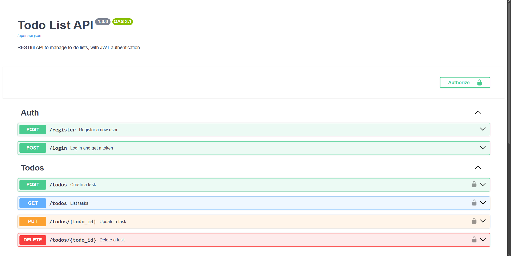
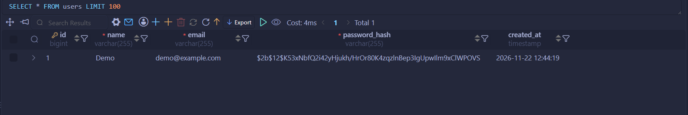

# Todo List API

API RESTful para gerenciar listas de tarefas, com cadastro, login e autenticação por token. Cada usuário enxerga e altera **apenas as próprias tarefas**.
Focado em autenticação, modelagem de banco de dados, design de API REST e segurança.

---



---

# Índice

- [Sobre o projeto](#todo-list-api)
- [Funcionalidades](#funcionalidades)
- [Endpoints](#endpoints)
- [Segurança](#segurança)
- [Tecnologias](#tecnologias)
- [Decisões técnicas](#decisões-técnicas)
- [Instalação e execução](#como-rodar)
- [Exemplos](#exemplos)
- [Códigos de resposta](#códigos-de-resposta)
- [Estrutura do projeto](#estrutura-do-projeto)
- [Autor](#autor)

# Funcionalidades

- Cadastro e login de usuários, com retorno de token JWT
- CRUD completo de tarefas
- Rotas de tarefas protegidas: só usuários autenticados acessam
- Autorização: só o dono da tarefa pode editá-la ou apagá-la
- Paginação, filtro por status e ordenação na listagem
- Validação de dados e tratamento de erros

# Endpoints

| Método | Rota | Descrição | Autenticação |
|---|---|---|---|
| POST | `/register` | Cria um usuário e devolve um token | Não |
| POST | `/login` | Autentica e devolve um token | Não |
| POST | `/todos` | Cria uma tarefa | Sim |
| GET | `/todos` | Lista as tarefas do usuário | Sim |
| PUT | `/todos/{id}` | Atualiza uma tarefa | Sim (só o dono) |
| DELETE | `/todos/{id}` | Apaga uma tarefa | Sim (só o dono) |

As rotas protegidas exigem o cabeçalho:

```
Authorization: Bearer <token>
```
**Usando o token nas rotas protegidas**

```
GET /todos
Authorization: Bearer SEU_TOKEN_JWT
```

# Segurança

- **Senhas** guardadas apenas como hash bcrypt, com salt. O limite de 72 bytes do bcrypt é validado antes do hash, no cadastro e no login, para que senhas longas ou com acentos nunca causem erro interno
- **Tokens JWT** assinados (HS256) e com expiração de 30 minutos. Tokens sem `exp` ou `sub`, ou com `sub` inválido, são rejeitados com 401
- **Chave JWT obrigatória**: sem valor padrão. A aplicação não inicia se a `SECRET_KEY` estiver ausente ou tiver menos de 32 caracteres
- **Segredos** (senha do banco e chave do JWT) em variáveis de ambiente, fora do repositório
- **Valores sempre parametrizados** nas consultas SQL, contra SQL injection. As únicas partes dinâmicas da query (ordenação) vêm de listas fixas de valores permitidos, nunca direto do cliente
- **E-mail único garantido pelo banco** (`UNIQUE`): cadastros simultâneos com o mesmo e-mail resultam em 409, sem erro interno
- **Autorização por dono**: cada usuário só acessa as próprias tarefas
- **Validação de entrada** com Pydantic, com limites de tamanho compatíveis com o banco e rejeição de textos só com espaços
- **Mensagem única no login**: não revela se o e-mail existe
---



---
# Tecnologias

- Python 3
- FastAPI
- MySQL (acesso com PyMySQL e SQL puro, sem ORM)
- JWT (PyJWT) para autenticação
- bcrypt para hash de senhas
- Pydantic para validação de dados

# Decisões técnicas

- Utilização de SQL puro para aprofundar o entendimento
  sobre consultas e interação com bancos relacionais.
- Separação da lógica de autenticação e autorização.
- Utilização de JWT para autenticação stateless.
- Implementação de paginação para evitar retornos excessivos.
- Validação de parâmetros de ordenação para evitar SQL Injection.

## Como rodar

### Pré-requisitos

- Python 3.10 ou superior
- MySQL instalado e rodando


1. Clone o repositório e entre na pasta:

```bash
git clone https://github.com/Pachecojiut/Todo-List-API.git
cd Todo-List-API
```

2. Crie e ative o ambiente virtual:

```bash
python -m venv .venv
.venv\Scripts\activate      # Windows
source .venv/bin/activate   # Linux/Mac
```

3. Instale as dependências:

```bash
pip install -r requirements.txt
```

4. Crie o banco e as tabelas executando o arquivo `database/schema.sql` no MySQL.

5. Copie o `.env.example` para `.env` e preencha com os seus dados:

```bash
cp .env.example .env
```

Para gerar uma `SECRET_KEY` segura:

```bash
python -c "import secrets; print(secrets.token_hex(32))"
```

6. Inicie o servidor:

```bash
uvicorn app.main:app --reload
```

A API fica em `http://127.0.0.1:8000`, e a documentação interativa em `http://127.0.0.1:8000/docs`.


### Exemplos

**Cadastro**

```json
POST /register
{
  "name": "John Doe",
  "email": "john@doe.com",
  "password": "password123"
}
```

Resposta:

```json
{ "token": "eyJhbGciOiJIUzI1NiIsInR5cCI6IkpXVCJ9..." }
```


**Criar tarefa**

```json
POST /todos
{
  "title": "Buy groceries",
  "description": "Buy milk, eggs, and bread",
  "status": "todo"
}
```

Resposta:

```json
{
  "id": 1,
  "title": "Buy groceries",
  "description": "Buy milk, eggs, and bread",
  "status": "todo"
}
```

**Listar tarefas**

```
GET /todos?page=1&limit=10&status=done&sort_by=created_at&order=desc
```

| Parâmetro | Descrição | Valores | Padrão |
|---|---|---|---|
| `page` | página atual | inteiro ≥ 1 | 1 |
| `limit` | itens por página | de 1 a 100 | 10 |
| `status` | filtra por status | `todo`, `in_progress`, `done` | sem filtro |
| `sort_by` | campo de ordenação | `id`, `title`, `created_at` | `id` |
| `order` | direção | `asc`, `desc` | `asc` |

Resposta:

```json
{
  "data": [
    { "id": 1, "title": "Buy groceries", "description": "Buy milk, eggs, and bread", "status": "done" }
  ],
  "page": 1,
  "limit": 10,
  "total": 1
}
```

### Códigos de resposta

| Código | Quando acontece |
|---|---|
| 200 | sucesso (login, listagem, atualização) |
| 201 | recurso criado (cadastro, tarefa) |
| 204 | tarefa apagada |
| 401 | token ausente, inválido ou expirado; login incorreto |
| 403 | tentativa de alterar tarefa de outro usuário |
| 404 | tarefa não encontrada |
| 409 | e-mail já cadastrado |
| 422 | dados inválidos |


## Estrutura do projeto

```
Todo-List-API/
├── app/
│   ├── main.py            # criação da aplicação e registro das rotas
│   ├── database.py        # conexão com o MySQL
│   ├── schemas.py         # modelos de entrada e saída (Pydantic)
│   ├── security.py        # hash de senha e tokens JWT
│   ├── dependencies.py    # autenticação das rotas protegidas
│   └── routers/
│       ├── users.py       # cadastro e login
│       └── todos.py       # CRUD de tarefas
├── database/
│   └── schema.sql         # criação do banco e das tabelas
├── .env.example
├── requirements.txt
└── README.md
```


## Autor

Feito por [Pachecojiut](https://github.com/Pachecojiut).

[Linkedin](https://www.linkedin.com/in/davimacedopacheco/)